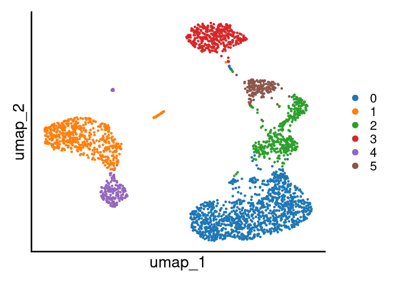
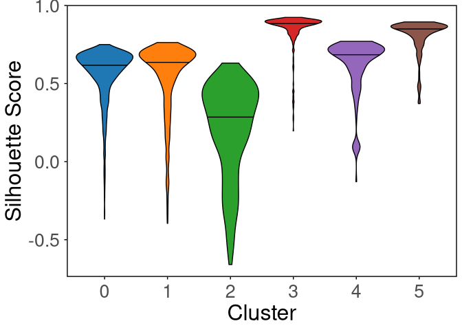
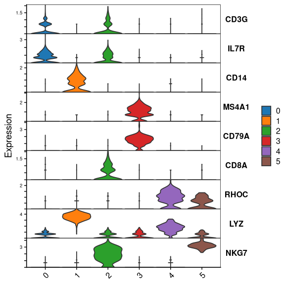
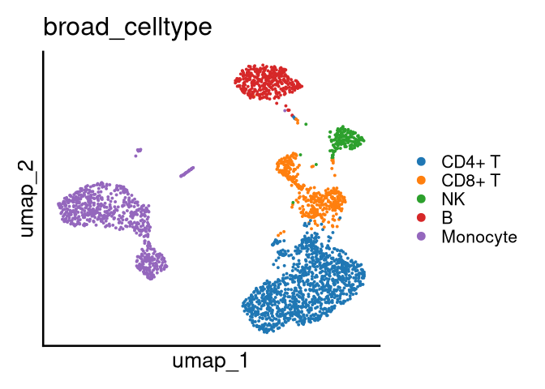
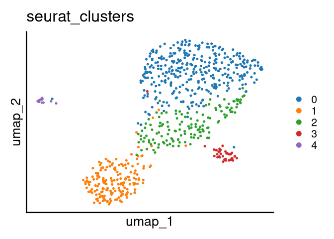

<!-- README.md is generated from README.Rmd. Please edit that file -->

# `scissors`

<!-- badges: start -->
<!-- badges: end -->

This package enables researchers to efficiently, accurately, and
reproducibly uncover rare celltypes and other small subgroups using an
iterative reclustering optimization routine built as an extension to a
typical `Seurat` workflow. Tools are included to preprocess data,
identify potential targets for subgroup analysis, optimize reclustering,
and annotate results. A preprint detailing the method & some biological
results is available [on
BioRxiv](https://doi.org/10.1101/2021.10.29.466448).

The SCISSORS package was initially released at
<https://github.com/jr-leary7/SCISSORS> and has been migrated to
<https://github.com/laurapeng/scissors> to support long-term
maintenance.

# Installation

## Software Requirements

- R (version ≥ 4.1.0)
- Required R packages:
  - SCISSORS: <https://github.com/laurapeng/scissors>
  - Seurat (version ≥ 5.2.0)
  - SeuratData (version 0.2.2.9002)
  - SeuratObject (version 5.1.99.9000)
  - dplyr (version 1.1.4)
  - ggplot2 (version 3.5.2)
  - paletteer (version 1.6.0)
  - ggpubr (version 0.6.1)
  - gridExtra (version 2.3)

``` r
# install.packages(c("Seurat", "SeuratData", "gridExtra", "phateR", "remotes"))
# library(remotes)
# 
# remotes::install_version("dplyr", version = "1.1.4")
# remotes::install_version("ggplot2", version = "3.5.2")
# remotes::install_version("paletteer", version = "1.6.0")
# remotes::install_version("ggpubr", version = "0.6.1")
# remotes::install_github("mojaveazure/seurat-object", ref = "6455e9b")
# remotes::install_github("laurapeng/scissors") 
# remotes::install_github("satijalab /seurat-data")
# 
# install.packages("BiocManager")
# BiocManager::install("glmGamPoi")
```

# Usage

## Libraries

First we’ll need to load our package as well as a couple dependencies.

``` r
library(scissors) 
library(dplyr) 
library(Seurat) 
library(ggplot2) 
library(SeuratData) 
library(paletteer) 
library(ggpubr)
library(gridExtra)
library(tibble)
```

## Load and Preprocess the PBMC3K Dataset

Following scRNA-seq tool development tradition, we’ll use the [10X
Genomics 3,000 PBMCs
dataset](https://support.10xgenomics.com/single-cell-gene-expression/datasets/1.1.0/pbmc3k)
as an example of our workflow. The raw reads can be downloaded from
10X’s site, and processed counts are available in the `SeuratData`
package.

``` r
InstallData("pbmc3k")
pbmc <- LoadData("pbmc3k")

set.seed(629)

pbmc <- PrepareData(pbmc, 
                    use.sct = TRUE, 
                    n.HVG = 4000, 
                    regress.cc = FALSE, 
                    regress.mt = FALSE, 
                    n.PC = 15, 
                    which.dim.reduc = "umap", 
                    initial.resolution = .4, 
                    use.parallel = FALSE, 
                    random.seed = 629)
#> [1] "Running UMAP on 15 principal components"
#> [1] "Found 6 unique clusters"
```

## Visualize Clustering Results

Visualizing the broad clusters on our UMAP embedding, we can see a few
clusters that seem heterogeneous enough to be reclustered.

``` r
DimPlot(pbmc,pt.size = 0.75)+ 
    scale_color_paletteer_d("ggthemes::Classic_10") + 
    theme_classic(base_size = 20) + 
    theme(axis.text = element_blank(), 
          axis.title.x = element_text(size = 20), 
          axis.title.y = element_text(size = 20), 
          axis.ticks = element_blank())
```



## Compute and Visualize Silhouette Scores for Each Cluster

To evaluate the heterogeneity within each broad cluster, silhouette
scores are computed for individual cells, and their distributions across
clusters are visualized using violin plots. Lower median silhouette
scores, or broader distributions extending toward negative values,
indicate potential internal heterogeneity and suggest that the
corresponding clusters may contain subpopulations worth re-clustering.
Clusters 0, 1, 2, and 4 exhibit lower median silhouette scores and
broader distributions extending toward negative values. This indicates
significant internal heterogeneity within these broad groups, suggesting
that they may contain distinct subpopulations that require further
investigation through re-clustering.

``` r
sil_df <- ComputeSilhouetteScores(pbmc, avg = FALSE) 

ggplot(sil_df, aes(x = Cluster, y = Score, fill = Cluster)) +    geom_violin(draw_quantiles = 0.5, 
                color = "black", 
                scale = "width") + 
   scale_fill_paletteer_d("ggthemes::Classic_10") + 
   labs(y = "Silhouette Score", 
        fill = NULL) + 
   theme_minimal() + 
   theme(panel.grid = element_blank(), 
         panel.border = element_rect(fill = NA,size = 1), 
         legend.position = "none", 
         axis.ticks = element_line(), 
         axis.title.x = element_text(size = 24), 
         axis.title.y = element_text(size = 24), 
         axis.text.x = element_text(size = 20),
         axis.text.y = element_text(size = 20))
```



## Visualize Marker Gene Expression

Looking at the expression of canonical marker genes allows us to assign
a most-likely celltype identity to each broad cluster. This biological
knowledge aids in the reclustering process i.e., we know that it’s
probably best to recluster clusters 1 & 1 simultaneously, as they’re
both composed of monocyte cells.

``` r
markers <- c("CD3G", "IL7R",    # CD4+ T
             "CD14",            # CD14+ monocyte
             "MS4A1", "CD79A",  # B 
             "CD8A",            # CD8+ T
             "RHOC",            # CD16+ monocyte
             "LYZ",             # monocyte
             "NKG7")            # NK

VlnPlot(pbmc, 
features = markers,
stack = TRUE, 
flip = TRUE, 
fill.by = "ident") +
scale_fill_paletteer_d("ggthemes::Classic_10") + 
labs(y = "Expression") + 
theme(axis.title.x = element_blank())
```



## Annotate Broad Cell Types

To aid downstream interpretation and re-clustering, broad cell type
labels are assigned to each cluster based on marker expression. Labels
are stored in meta.data\$broad_celltype. The annotations are then
visualized on UMAP using group.by = “broad_celltype”.

``` r
pbmc@meta.data <- mutate(pbmc@meta.data, 
                         broad_celltype = case_when(seurat_clusters == "0" ~ "CD4+ T", 
                                                    seurat_clusters == "1" ~ "Monocyte", 
                                                    seurat_clusters == "2" ~ "CD8+ T", 
                                                    seurat_clusters == "3" ~ "B", 
                                                    seurat_clusters == "4" ~ "Monocyte", 
                                                    seurat_clusters == "5" ~ "NK", 
                                                    TRUE ~ NA_character_), 
                         broad_celltype = factor(broad_celltype, levels = c("CD4+ T", 
                                                                            "CD8+ T", 
                                                                            "NK", "B", 
                                                                            "Monocyte"))
                         ) 
DimPlot(pbmc, group.by = "broad_celltype") + 
  scale_color_paletteer_d("ggthemes::Classic_10") +
  theme_classic(base_size = 20) + 
  theme(axis.text = element_blank(), 
        axis.title.x = element_text(size = 20), 
        axis.title.y = element_text(size = 20), 
        axis.ticks = element_blank())
```



## Find Markers for Broad Clusters

To characterize the broad cell clusters, differential expression (DE)
analysis is performed using the FindBroadMarkers() function. The
analysis is run on the SCT assay with the Wilcoxon rank-sum test,
requiring a minimum expression in 25% of cells per cluster (min.pct =
0.25), a log2 fold-change threshold of 0.25, and a false discovery rate
cutoff of 0.05, and excluding genes in the top 10% of mean expression in
other clusters (perc.cutoff = 0.9). For each broad cluster, the top five
genes with the highest average log2 fold-change are selected as markers.

``` r
pbmc_de_broad <- FindBroadMarkers(pbmc, 
                                        assay.use = "SCT",
                                        slot.use = "data",
                                        ident.use = "broad_celltype",
                                        de.method = "wilcox",
                                        min.pct = 0.25,
                                        perc.cutoff = 0.9,
                                        log2fc.cutoff = 0.25,
                                        fdr.cutoff = 0.05) 
top5_pbmc_de_broad <- pbmc_de_broad %>% 
  group_by(cluster) %>%
  arrange(desc(avg_log2FC)) %>% 
  slice_head(n = 5) 
```

## Plot Top 5 Marker Genes for Broad Cell Types

Visualize the top 5 Marker Genes for Broad Cell Types that are enriched
in each broad immune cell type.

``` r
DotPlot(pbmc,
        features = unique(top5_pbmc_de_broad$gene),
        dot.scale = 10,
        group.by = "broad_celltype") + 
   scale_size(range = c(1, 10)) + 
   scale_color_gradientn(colors = paletteer_d("wesanderson::Zissou1")) +
   labs(color = "ScaledExpression", size = "% Expressed", y = "") + 
   theme(axis.text.x = element_text(angle = 90, size = 16, vjust = 0.5), 
         legend.position = "right", 
         legend.justification = "center", 
         panel.border = element_rect(fill = NA, size = 1, color = "black"), 
         axis.line = element_blank(), 
         legend.title = element_text(size = 18), 
         axis.title.x = element_blank(), 
         axis.title.y = element_text(size = 20), 
         axis.text.y = element_text(size = 18)) + 
   guides(color = guide_colorbar(title.position = "top", 
                                 barheight = unit(3, units = "cm"), 
                                 title.hjust = 0.5), 
          size = guide_legend(title.position = "top", 
                              title.hjust = 0.5))
```


## Re-cluster Candidate Broad Clusters

Based on silhouette scores and marker-based annotations, the monocyte
groups (clusters 1 and 4) are selected for re-clustering. These clusters
are merged and re-clustered using ReclusterCells() with SCTransform
normalization (use.sct = TRUE), 4,000 highly-variable genes (HVGs), and
15 PCs. Note that the 4,000 HVGs are re-derived considering only cells
in the candidate broad clusters instead of the full dataset. A parameter
grid over k-nearest neighbors (k.vals = c(10, 20, 30)) and clustering
resolution (resolution.vals = c(0.3, 0.4, 0.5)) is evaluated with
re-embedding (redo.embedding = TRUE) under a fixed seed (629) to
optimize cluster separation while maintaining stability.

``` r
mono_reclust <- ReclusterCells(pbmc, 
                               use.sct = TRUE, 
                               which.clust = list(1, 4), 
                               merge.clusters = TRUE, 
                               n.HVG = 4000,
                               n.PC = 15, 
                               k.vals = c(10, 20, 30), 
                               resolution.vals = c(.3, .4, .5), 
                               redo.embedding = TRUE, 
                               random.seed = 629,
                               use.parallel = FALSE)
#> [1] "Reclustering cells in clusters 1, 4 using k = 10 & resolution = 0.3; S = 0.432"

DimPlot(mono_reclust, group.by = "seurat_clusters") + 
  scale_color_paletteer_d("ggthemes::Classic_10") +
  theme_classic(base_size = 20) + 
  theme(axis.text = element_blank(), 
        axis.title.x = element_text(size = 20), 
        axis.title.y = element_text(size = 20), 
        axis.ticks = element_blank())
```



## Identify Monocyte Subtypes

After re-clustering, markers are examined for annotation, including CD14
(classical monocytes), FCGR3A (non-classical monocytes), HLA-DRA
(intermediate monocytes), LYZ (monocyte), PPBP (platelet), and FCER1A
(dendritic cell or DC). These expression profiles allow finer cell
labels to be assigned to each subcluster.

``` r
markers <- c("FCER1A",  # DC
"PPBP", # Platelets
"LYZ",  # monocyte
"CD14", # Classical monocytes
"FCGR3A",   # Non-classical monocyte
"HLA-DRA"
)
VlnPlot(mono_reclust,   # Intermediate monocyte
      features = markers, 
      stack = TRUE, 
      flip = TRUE, 
      fill.by = "ident") +
     scale_fill_paletteer_d("ggthemes::Classic_10") + 
     labs(y = "Expression") + 
     theme(axis.title.x = element_blank())
```


## Integrate Monocyte Subcluster

The subclusters are integrated into the Seurat object, and refined
subcluster annotations are assigned. These annotations are stored in the
metadata column mono_dc_platelets_subcelltype and visualized using UMAP.

``` r
mono_reclust@meta.data <- mono_reclust@meta.data %>%
  mutate(
    mono_dc_platelets_subcelltype = case_when(
      seurat_clusters == "0" ~ "M0.Classical monocyte", 
      seurat_clusters == "1" ~ "M2.Non-classical monocyte", 
      seurat_clusters == "2" ~ "M1.Intermediate monocyte", 
      seurat_clusters == "3" ~ "DC", 
      seurat_clusters == "4" ~ "Platelets", 
      TRUE ~ NA), 
    mono_dc_platelets_subcelltype = factor(mono_dc_platelets_subcelltype, 
                              levels = c("M0.Classical monocyte", 
                                         "M1.Intermediate monocyte", 
                                         "M2.Non-classical monocyte", 
                                         "DC", 
                                         "Platelets"))
  )

DimPlot(mono_reclust, group.by = "mono_dc_platelets_subcelltype") + 
  scale_color_paletteer_d("ggthemes::Classic_10") +
  theme_classic(base_size = 20) + 
  theme(axis.text = element_blank(), 
        axis.title.x = element_text(size = 20), 
        axis.title.y = element_text(size = 20), 
        axis.ticks = element_blank())
```


## Assess Marker Expression Across Monocyte Subtypes

The expression of marker genes is further visualized across the three
monocyte subtypes: classical, intermediate, and non-classical. The
re-clustered object is subset to include only classical (M0),
intermediate (M1), and non-classical (M2) monocytes and the expression
profiles are visualized using violin plots. Wilcoxon rank-sum tests with
FDR correction are applied to assess statistical differences across all
pairwise subtype comparisons.

``` r
keep_clusters <- c("M0.Classical monocyte",
                   "M1.Intermediate monocyte",
                   "M2.Non-classical monocyte")

 obj_sub <- subset(mono_reclust, mono_dc_platelets_subcelltype %in% keep_clusters)
 gene <- c("CD14",           # M0.Classical monocyte
           "FCGR3A",         # M2.Non-classical monocyte
           "HLA-DRA"         # M1.Intermediate monocyte
           )

violinplot_list <- list()
 
for (Gene_tmp in gene) {
  df <- FetchData(obj_sub, vars = c("mono_dc_platelets_subcelltype", Gene_tmp))
 
  p <- ggplot(df, aes(x = mono_dc_platelets_subcelltype,
                      y = .data[[Gene_tmp]], 
                      fill = mono_dc_platelets_subcelltype)) +
    geom_violin( scale = "width", width = 0.8) +
    stat_summary(fun = "median", geom = "point", size = 1.5) +
    stat_compare_means(
      method = "wilcox.test",
      label = "p.signif",
      comparisons = combn(keep_clusters, 2, simplify = FALSE),
      p.adjust.method = "fdr",
      size = 3
    ) +
    theme_classic(base_size = 10) +
    labs(x = NULL, y = Gene_tmp) +
    theme(legend.position = "none",
          axis.text.x = element_text(angle = 60, hjust = 1, vjust = 1)
    )
 
  violinplot_list[[Gene_tmp]] <- p
}

 grid.arrange(grobs = violinplot_list, ncol = 3)
```


## Add Subclusters to the Broad Cluster

The monocyte subclusters are integrated into the broader annotation
framework. This is achieved by joining the re-clustered metadata with
the original Seurat object and updating the annotation column
broad_celltype_fine.

``` r
mono_reclust_annotation <- levels(mono_reclust@meta.data$mono_dc_platelets_subcelltype)

fine_map_tbl <- tibble(
  cell = colnames(mono_reclust),
  broad_celltype_fine = mono_reclust$mono_dc_platelets_subcelltype
)

pbmc_meta <- pbmc@meta.data %>%
  rownames_to_column("cell")

pbmc_joined <- pbmc_meta %>%
  left_join(fine_map_tbl, by = "cell")


pbmc_joined <- pbmc_joined %>%
  mutate(
    broad_celltype_fine = if_else(is.na(broad_celltype_fine), 
                                  broad_celltype,
                                  broad_celltype_fine)
  )

pbmc@meta.data <- pbmc_joined %>%
  column_to_rownames("cell")

DimPlot(pbmc, group.by = "broad_celltype_fine",cols = paletteer_d("ggthemes::Classic_10"))+
    theme_classic(base_size = 20) + 
    theme(axis.text = element_blank(), 
        axis.title.x = element_text(size = 20), 
        axis.title.y = element_text(size = 20), 
        axis.ticks = element_blank())
```


## Find Top Marker Genes for DC and Platelets

DCs and platelets are biologically distinct from the monocyte lineage
and are thus chosen to be analyzed separately. To characterize the CD
and platelet subclusters, DE analysis is performed using the
FindSubtypeMarkers() function. Genes are retained only if they are
significantly enriched after filtering out genes broadly expressed
across other broad cell types in the full dataset. The resulting markers
are then filtered to retain only those associated with the DC and
platelet subclusters. For each group, the top five marker genes with the
highest average log2 fold-change are selected as defining features.

``` r
DC_platelets_SubtypeMarkers <- FindSubtypeMarkers(obj.1 = mono_reclust,
                                                obj.2 = pbmc,
                                                ident.1 = "mono_dc_platelets_subcelltype",
                                                ident.2 = "broad_celltype_fine",
                                                de.method = "wilcox",
                                                min.pct = 0.25,
                                                fdr.cutoff = 0.05,
                                                log2fc.cutoff = 0.25,
                                                perc.cutoff = 0.95,
                                                extra.cell.filter = NULL)

top5_DC_platelets_SubtypeMarkers <- DC_platelets_SubtypeMarkers %>% 
  group_by(cluster) %>% 
  filter(cluster %in% c("DC","Platelets")) %>%
  arrange(desc(avg_log2FC)) %>% 
  slice_head(n = 5) 
```

## Find Top Marker Genes for Monocyte Subtypes

To characterize the three monocyte subtypes, the re-clustered object is
first restricted to classical, intermediate, and non-classical
monocytes. DE analysis is then performed using FindSubtypeMarkers(),
comparing each monocyte subtype against other monocyte subtypes, then
filtering out genes broadly expressed in non-monocyte cell types. For
each subtype, the top five marker genes ranked by average log2
fold-change are selected for downstream visualization.

``` r
keep_clusters <- c("M0.Classical monocyte","M1.Intermediate monocyte","M2.Non-classical monocyte")
M0M1M2_seurat <- subset(mono_reclust, mono_dc_platelets_subcelltype %in%  keep_clusters)
M0M1M2_seurat@meta.data <- M0M1M2_seurat@meta.data %>%
  mutate(mono_subcelltype = mono_dc_platelets_subcelltype)
M0M1M2_SubtypeMarkers <- FindSubtypeMarkers(obj.1 = M0M1M2_seurat,
                                                obj.2 = pbmc,
                                                ident.1 = "mono_subcelltype",
                                                ident.2 = "broad_celltype_fine",
                                                de.method = "wilcox",
                                                min.pct = 0.25,
                                                fdr.cutoff = 0.05,
                                                log2fc.cutoff = 0.25,
                                                perc.cutoff = 0.95,
                                                extra.cell.filter = NULL)

top5_M0M1M2_SubtypeMarkers  <- M0M1M2_SubtypeMarkers %>% 
  group_by(cluster) %>% 
  arrange(desc(avg_log2FC)) %>% 
  slice_head(n = 5) 
```

## Plot Top 5 Marker Genes for Monocyte Subclusters

``` r
top5_monocyte_merged <- rbind(top5_M0M1M2_SubtypeMarkers,
                              top5_DC_platelets_SubtypeMarkers)
DotPlot(mono_reclust, 
               features = unique(top5_monocyte_merged$gene), 
               dot.scale = 10,  
               group.by = "mono_dc_platelets_subcelltype") + 
   scale_size(range = c(1, 10)) + 
   scale_color_gradientn(colors = paletteer_d("wesanderson::Zissou1")) +
   labs(color = "ScaledExpression", size = "% Expressed", y = "") + 
   theme(axis.text.x = element_text(angle = 90, size = 16, vjust = 0.5), 
         legend.position = "right", 
         legend.justification = "center", 
         panel.border = element_rect(fill = NA, size = 1, color = "black"), 
         axis.line = element_blank(), 
         legend.title = element_text(size = 18), 
         axis.title.x = element_blank(), 
         axis.title.y = element_text(size = 20), 
         axis.text.y = element_text(size = 18)) + 
   guides(color = guide_colorbar(title.position = "top", 
                                 barheight = unit(3, units = "cm"), 
                                 title.hjust = 0.5), 
          size = guide_legend(title.position = "top",
                              title.hjust = 0.5))
```


# Conclusions & Best Practices

In general, it’s best if reclustering analyses are semi-supervised; you
want to have some idea of what’s going on / what could be possible
biologically, but it’s important to not have a predefined conclusion
that you’re looking for as well. Using biological background information
as well as cluster fit heuristics to choose reclustering targets is,
empirically, a good way to avoid false positives and ensure that your
reclustering results are biologically meaningful & reproducible. For
more complex analyses using `scissors` see our manuscript, and don’t
hesitate to reach out if you’d like help with using the package.

# Contact Information

This package is developed and maintained by Xianlu Laura Peng. Feel free
to ask for help via email (<laura.peng@med.unc.edu>) if more detailed
assistance is needed.

# References

1.  Leary, J. *et al*. [Sub-cluster identification through
    semi-supervised optimization of rare cell silhouettes (SCISSORS) in
    single-cell sequencing](https://doi.org/10.1101/2021.10.29.466448).
    *BioRxiv* (2021).

2.  10X Genomics. [3k PBMCs from a healthy donor: single cell gene
    expression dataset by Cell Ranger
    v1.1.0](https://support.10xgenomics.com/single-cell-gene-expression/datasets/1.1.0/pbmc3k).
    *10X Genomics Documentation* (2016).

3.  Rousseeuw, P. [Silhouettes: A graphical aid to the interpretation
    and validation of cluster
    analysis](https://doi.org/10.1016/0377-0427%2887%2990125-7).
    *Journal of Computational and Applied Mathematics* (1987).
